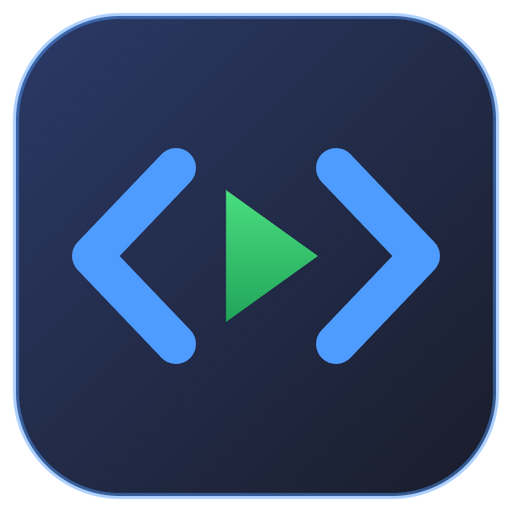

# CodeLab

**An offline coding playground for classrooms.** Write and run **Python, JavaScript, C and
C++** in one lightweight Windows app. No internet, no Docker, nothing else to install.

<p align="center"></p>

## Download

Get the installer from the **[latest release](https://github.com/Surajdotpy/codelab/releases/latest)**,
run it, and open **CodeLab** from the desktop shortcut.

- Needs 64-bit **Windows 10 or 11** and about 600 MB of disk space.
- Installs for your own account, so no administrator is needed.
- Windows may warn that the app is unsigned. Click **More info**, then **Run anyway**.

## Features
- Python, JavaScript, C and C++ in one window; Run with the button or **Ctrl+Enter**
- Syntax colors, line numbers, auto-indent, Tab key, **Ctrl +/−** to zoom
- Input box for programs that read from the keyboard (`input()`, `scanf`, `cin`)
- **Open** (Ctrl+O) and **Save** (Ctrl+S) program files; your last code in each language is remembered
- Safety limits for every program: 5 seconds, 256 MB of memory, 16 processes, 64 KB of output, so a runaway program can't freeze the PC
- Works fully offline. Python, the C/C++ compiler and Node.js are bundled inside the app

## Documentation

| Read this | If you are… |
|---|---|
| [User guide](docs/USER-GUIDE.md) | a student or teacher: installing, running programs, giving input, troubleshooting, setting up many PCs |
| [Contributing](CONTRIBUTING.md) | a developer who wants to fix a bug, add a feature, or add a language |
| [Architecture](docs/ARCHITECTURE.md) | curious how it works inside: the run flow, the editor, the security model |
| [Releasing](docs/RELEASING.md) | a maintainer publishing a new version (it's automatic) |
| [Progress](PROGRESS.md) and [Changelog](CHANGELOG.md) | checking what's done, what's not verified yet, and what changed in each version |
| [CLAUDE.md](CLAUDE.md) | using an AI coding assistant on this repo: project rules and gotchas |
| [Security policy](SECURITY.md) | reporting a vulnerability, or wondering how safe student code is |
| [Third-party notices](THIRD-PARTY-NOTICES.md) | checking the licenses of the bundled Python, Electron and GCC |
| [Code of conduct](CODE_OF_CONDUCT.md) | taking part in the project |

## Run from source

You need Windows 10 or 11, [Node.js](https://nodejs.org) 20 or newer, and git.

```
git clone https://github.com/Surajdotpy/codelab.git
cd codelab
npm install
powershell -ExecutionPolicy Bypass -File scripts\fetch-runtimes.ps1   # downloads Python + GCC, once
npm start        # opens the app
npm test         # runs the highlighter tests and a program in every language
npm run dist     # builds the installer into dist\
```

## How it works

| File | Job |
|---|---|
| `index.html`, `style.css`, `renderer.js` | The screen: language tabs, editor, input box, output |
| `highlight.js` | Small syntax colorizer (tested by `scripts/test-highlight.js`) |
| `preload.js` | The only bridge from the screen to the computer: `codelab.run/save/open()` |
| `main.js` | Opens the window, receives run, save and open requests |
| `runner.js` | Saves code to a temp folder, compiles C/C++, runs it with a 5 s limit |
| `scripts/limiter.c` | Tiny launcher that runs each program inside a Windows Job Object (memory and process caps) |

The app is built with Electron. JavaScript runs on the Node.js engine inside Electron, Python
is the official embeddable build, and C/C++ use GCC from [w64devkit](https://github.com/skeeto/w64devkit).
`scripts/fetch-runtimes.ps1` downloads and trims them.

## Safety

Every program runs inside a Windows Job Object with a 5 second limit, a 256 MB memory cap and a
16-process cap, and everything it starts is killed when it stops. The window itself is locked down
(sandboxed, strict Content-Security-Policy, no navigation, no DevTools in the installed app).

Student programs still run with the signed-in Windows user's permissions and can read or delete
that user's files. **This is not a sandbox**, so use a standard (non-administrator) Windows account
on lab PCs. Details are in [SECURITY.md](SECURITY.md).

## License

CodeLab is released under the [MIT License](LICENSE). The installer bundles Python, Electron
and GCC, which have their own licenses (see [THIRD-PARTY-NOTICES.md](THIRD-PARTY-NOTICES.md)).
